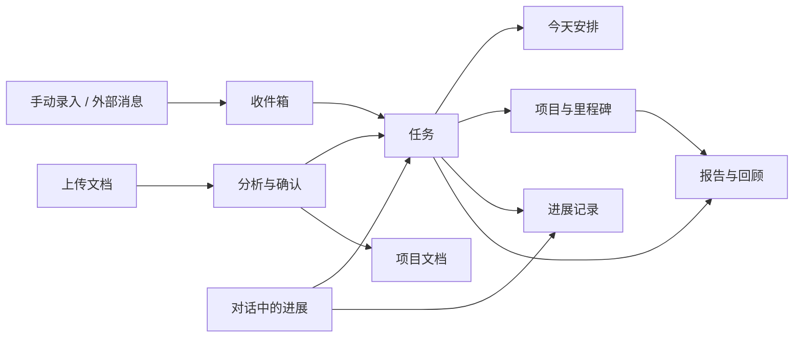

# 知序操作手册

适用版本：0.2.8。更新日期：2026-10-25。

本手册以 Windows 桌面版为准。通过“网页访问”开启的 HTTPS 工作台与桌面共用数据，使用方法见第 13 节；开发端口上的本地浏览器预览仍有独立数据。插件、终端、本机目录和原生浏览器功能在桌面使用。

## 1. 从哪里开始

1. 安装 GitHub Releases 中的 `Zhixu-0.2.8-Windows-Setup.exe`，从桌面的“知序”打开。
2. 点击左侧上方的工作台头像，设置姓名、工作台信息和头像，保存。头像支持 JPG、PNG、WebP，最大 5 MB；也可以选择颜色。
3. 如需 AI 问答和文档理解，在个人设置中配置供应商，具体见第 3 节。不配置时仍能手动管理项目、任务，并使用本地事项整理规则。
4. 到“项目”创建实际项目，填写负责人、目标和干系人。
5. 使用“添加事项”录入工作，或上传资料分析，再检查日期、负责人和任务内容。

首次运行会显示示例资料。示例不代表你的真实项目；新建自己的项目后，再按需要逐项处理示例，避免误删实际工作记录。

升级时正常关闭知序，再运行新版安装包，沿用原程序、原快捷方式和原数据。当前没有自动更新功能，无需另建一个按版本命名的桌面入口。

## 2. 各模块如何关联

| 模块 | 主要用途 | 关联结果 |
| --- | --- | --- |
| 今天 | 看某一天的任务、预计投入、计时和逾期事项 | 与项目任务共用同一条任务，完成或改期会同步 |
| 对话 | 问答、整理资料、下指令、报告工作进展 | 确认草稿后写入任务或项目；明确进展可同步已有工作 |
| 收件箱 | 接住尚未确认的消息和事项 | 确认后成为任务，原文保留；不是所有消息都自动变成任务 |
| 项目 | 按项目查看目标、任务、里程碑、风险、进展和文档 | 任务状态影响项目进度、下一节点及关联提醒 |
| 报告 | 按日期或类型整理现有工作记录 | 基于任务、项目和计时汇总，可编辑、保存快照和导出 |
| 回顾 | 看任务完成情况、投入和个人实验 | 数据来自已有记录；计时记录与预计工时是不同信息 |
| 连接与数据 | 管理连接器、插件、工作约定、自定义字段和备份 | 外部消息先进入收件箱；字段供任务、项目、风险填写 |

左侧数量角标分别提示今天未完成任务、收件箱待处理事项和项目数。窄窗口保留角标；超过 99 显示 `99+`，悬停查看完整数量。不同模块的统计口径不同，例如“项目”统计仅包含已关联项目的任务。

顶部铃铛打开“本地简报”，查看待确认、等待事项、计时及关注的里程碑。它不是系统推送通知，也不会在退出知序后自动发提醒。

## 3. 配置模型并开始对话

### 3.1 配置供应商

1. 点击工作台头像，进入个人设置中的模型/供应商配置。
2. 选择已有供应商，或自定义供应商，填写 API 地址和 API Key。地址与密钥从你使用的供应商后台取得。
3. 获取模型列表并选择模型；供应商没有提供列表时，可手动填写其支持的模型名。
4. 使用供应商诊断，检查配置、模型列表和真实文本请求。根据实际情况选择或识别 Chat Completions / Responses 协议。
5. 保存配置。顶部与对话输入区应显示当前模型；每条回复下方显示该条回复实际使用的模型。

诊断失败时查看具体的接口路径、HTTP 状态、耗时和处理建议。认证错误优先核对密钥与权限；模型不存在时核对模型名；网络超时先检查接口地址和网络。模型列表能获取，不代表真实问答一定成功，需同时检查真实请求结果。

密钥填写在应用内，不要粘贴到对话、手册、截图或 GitHub。桌面版凭据使用 Windows 系统安全存储加密。

### 3.2 提问、下指令、更新进展

在“对话”输入问题，按 Enter 发送，Shift + Enter 换行。已配置模型时使用所选模型的能力；接口失败会显示原因和重试入口，不会悄悄换成本地规则回答。

建议说明项目、工作对象和实际情况：

| 目的 | 示例 | 处理方式 |
| --- | --- | --- |
| 问答 | “帮我分析青禾小学的部署风险” | 结合当前可用项目上下文回答 |
| 新增任务 | “给青禾小学加一个验收任务，负责人小王，11 月 2 日截止” | 检查任务草稿，确认后写入 |
| 更新已有工作 | “青禾小学的教室维修已完成，设备部署进行中” | 匹配已有任务并同步明确状态；对象不清楚时先确认 |
| 只补备注 | “给验收任务记一条备注：客户要求周五提供照片，先不改状态” | 追加记录，保留已有完成状态 |
| 假设或咨询 | “如果维修完成了，下一步怎么安排？” | 不应按真实完成事件修改任务 |

对话显示的“建议”“草稿”和已执行结果不同。保存后到对应项目检查实际任务、进度与进展记录；不要把普通文字回复当作已落库结果。

长对话达到规模阈值后，会使用所选模型生成并缓存交接摘要，后续结合摘要和近期原文继续问答。“参考内容 → 对话记忆”可查看摘要，“查看更早消息”可分批阅读完整历史。摘要本身也消耗 token，且是有损整理；精确措辞以原聊天记录为准。

### 3.3 工作区：文件、浏览器、终端

在“对话”点击“工作区”，按需要打开侧栏：

- **文件**：选择本地文件夹，浏览文件或查看已上传附件。文本、图片可预览，其他格式可交给系统应用打开。选中本地文件夹只是浏览，不等于整文件夹已上传或已分析。
- **浏览器**：输入网页地址，使用前进、后退和刷新。在桌面版内打开独立网页视图。
- **终端**：运行 PowerShell 命令，查看输出和历史，可停止或重启。目录与变量在该终端会话中保留；不支持完整交互式 TUI。

文件夹授权限本次应用会话，重启后需要重新选择。当前模型不会因为一句聊天或文件中的文字就自动操控浏览器、执行终端命令或调用插件。

## 4. 创建项目、管理人员和里程碑

### 4.1 新建与编辑

进入“项目 → 新建项目”，填写项目名称、负责人和目标。展开“进度与其他信息”可填写代号、健康度、节点、自定义字段和项目备注。

在“干系人”点击“添加干系人”，填写姓名和角色；可继续添加、修改或移除，最后点击“保存项目”。项目概览也提供管理入口。干系人用于记录人员关系，不代表向这些人发出邀请或自动开通账号。

新项目会自动分配颜色，项目卡片、侧栏圆点保持一致，重启后保留。卡片与列表视图均可打开项目，列表中的操作列可编辑、删除。

### 4.2 项目详情

| 页签 | 如何使用 |
| --- | --- |
| 概览 | 查看目标、负责人、健康度、任务概况和人员 |
| 任务 | 添加事项，编辑任务、状态、日期、进度、详细内容与备注；可切换看板 |
| 里程碑 | 新增或编辑阶段节点，设置日期，并关联本项目内的任务 |
| 风险 | 记录风险内容、级别、负责人等信息，跟踪处理并关闭 |
| 进展记录 | 按时间逐条查看任务及项目进展，查看来源、记录人及保留的原话 |
| 文档 | 上传资料、查看分析、编辑任务草稿、导出原文件 |

### 4.3 进度为什么会同步

任务状态与完成比例是项目推进的依据。将某项任务标记完成，会更新项目完成比例、关联里程碑、下一节点和相关提醒；“今天”、项目任务列表、侧栏及报告使用同一份工作记录。

关联任务全部完成后，对应里程碑可自动完成；还有关联任务未完成时，不能直接把该里程碑标为完成。有未完成里程碑时，不会仅因其他任务完成就误记整个项目为 100%。重新打开、修改或删除任务后也会重新计算。

只说“维修完成”，不会自动代表设备部署、联调、验收或整个项目完成。任务合并后，其详细工作仍需整体完成，才能把整项置为完成。

手动填写项目进度适合补充项目概况；后续实际任务变更会按关联工作重新计算，不宜仅改总百分比代替逐项维护状态。

### 4.4 删除项目

项目详情或项目列表点击“删除”，先检查确认窗口中的影响范围。删除后项目归档，关联任务保留并改为未归属，附件也保留，不会随项目一并永久删除。若工作只是暂时停止，优先记录状态和原因，避免删除后丢失项目关联。

## 5. 添加事项、安排任务、记录备注

### 5.1 把大白话变成任务

1. 在项目内点击“添加事项”，或通过顶部“新建”打开事项录入。
2. 填写实际描述，例如：“青禾小学教室的灯还没装，明天下午安排小王安装，再拍照给客户。”
3. 点击“解析”，检查简短任务标题，补全负责人、日期、预计时长和优先级。具体步骤放入“详细”。
4. 内容不合适时修改原文并“重新解析”；修改原文后需重新解析，不能保存旧的解析结果。
5. 点击底部“确认保存”。取消、重新解析和确认保存在同一排。

配置模型后使用模型整理；未配置时使用本地规则。缺少信息要自行补充，不把估计当成已确认的承诺。

### 5.2 编辑与完成

在“今天”或项目任务页点击编辑图标，设置：

- 任务标题、项目和负责人。
- **安排日期**：计划在哪一天做，影响哪一天显示和容量。
- **截止日期**：最晚完成日期，使用日期选择器，可清除。
- 预计小时、优先级、状态、完成进度和详细内容。
- “新增进展备注”以及已启用的自定义字段。

点击完成勾选或把状态改为“已完成”，再检查关联项目的变化。重新打开任务后，关联进度会重新计算。删除任务需要确认，原文与记录留在本机归档，不等于收件箱回收站中的可恢复消息。

### 5.3 备注按时间保留

任务行的备注入口或编辑任务中的“新增进展备注”用于追加本次记录。每次提交追加一条，既有历史不会被新内容覆盖。任务状态与进度变化也会留存记录。

对话更新会将口语整理为项目表达，并保留原话、记录人和精确时间；在任务编辑窗和项目“进展记录”查看。旧资料没有可靠时间时会显示“时间未记录”，不会补造日期。

只新增备注不代表任务完成。需要同时变更状态时，应明确说明或在编辑窗口选择。

## 6. 今天、计时和逾期事项

1. 打开“今天”，通过日期切换查看不同日期的安排，检查预计投入及剩余时间。
2. 按需要调整工作时间，使用任务筛选与排序，区分必须做、应该做、可以做。
3. 开始任务时点击计时入口，暂停或结束时停止计时。预计时长用于规划，计时记录反映实际投入。
4. 发现排不下的任务时调整安排日期，不把所有工作默认塞进今天。

逾期提示由实际任务的截止日期计算，不是单独的一份清单。“逾期事项”中可选择“改期 / 编辑”或“安排到今日”。

- **工作实际做完了**：完成对应任务，该项逾期提醒消失。
- **只是补充清单或备注**：仍未完成且截止日期已过，提醒继续保留是正常的。
- **决定延期**：选择新的截止日期并保存；过期任务改期时也要核对最终截止日期。
- **安排到今天处理**：只处理选中的那一项，其他逾期事项继续保留。不要为消除提醒将所有任务一次性完成。

## 7. 收件箱

收件箱用于处理还没明确归属或安排的事项，可以手动添加，也可以接收连接器手动同步的消息。

1. 点击一条待处理消息，阅读原文和解析建议。
2. 核对项目、任务内容、日期和估时，确认后加入任务。
3. 一个消息包含多项独立工作时使用拆分；暂时不做的消息可忽略或归档。
4. 使用批量整理处理多条内容，先核对选中范围。

垃圾桶按钮将收件箱消息移入回收站，可在“归档与回收站”恢复。“清空”需再次确认，按确认窗口的范围处理；永久清空后无法在应用中恢复，清空前应确认已不需要原记录。

收件箱待处理数会随确认、删除或归档更新。连接器再次同步时会核对来源标识，避免相同消息重复进入。

## 8. 上传 Word、Excel、PDF、PowerPoint

### 8.1 格式和容量

| 文件类型 | 可上传格式 |
| --- | --- |
| Word | `.doc`、`.docx` |
| Excel | `.xlsx` |
| PDF | `.pdf` |
| PowerPoint | `.pptx` |
| 文本与表格文本 | `.txt`、`.md`、`.csv` |

**每份文件不超过 50 MB**，单份提取正文最多 100 万字。旧 `.xls`、`.ppt` 需先另存为 `.xlsx`、`.pptx`；加密文件先解除密码。扫描件、截图和图片型 PDF 需先做 OCR，当前不自动识别图片中的文字。

### 8.2 上传、分析、确认

1. 从对话输入区加号上传，或在“项目 → 文档”上传；选择一份或多份支持的文件。
2. 选择项目归属、分析方式和通用分析指令。需要理解自定义要求时选择已配置的模型，本地规则只提供基础提取。
3. 上传后检查每份文件的解析、分析状态。原文件先保存，解析结果和分析结果分别记录。
4. 归属唯一明确的已有项目可自动归档并生成任务；未知或多项目归属需人工确认。
5. 新项目先保留草稿。检查新项目名、摘要、任务和分析指令，明确确认后才创建项目。
6. 检查任务标题、详细步骤、负责人、日期、工时及优先级，使用“保存到项目”或相应确认按钮。
7. 保存后回到对话，查看简短摘要和任务概览；点击“详细”定位关联项目并打开附件任务清单。

文件夹浏览与文档上传是两项操作：只在工作区选择文件夹，不会自动批量分析其中全部文件；应在上传入口选择需要分析的文档。

### 8.3 调整分析与合并任务

按交付物或阶段保留简洁任务，把具体步骤放在“详细”中。必要时勾选相关任务，填写合并标题再合并。已有任务负责人、日期或里程碑不同的工作会分别保留，避免误合并责任和截止时间。

合并保留原备注和完成比例；对合并后的整项确认完成，才同步关联状态。只完成其中一部分时记录部分进展。

在附件编辑中使用“保存修改”同步现有分析；归属变更按确认归档流程处理。重新分析前阅读确认提示，已有任务会保留，新增候选需检查后保存。编辑分析不会改写原 Office/PDF 文件。

### 8.4 失败后怎么处理

失败文件继续保持选中，项目和指令保留，查看每份文件的具体错误，再重试失败项。已成功文件无需重新上传。正文解析失败的附件仍可保留原文件记录，使用“重新解析”或“导出原文件”处理。

常见原因包括格式不支持、文件超限、加密或损坏、扫描件没有可提取正文、模型认证失败、接口超时或模型分析结果不符合要求。不要只反复点击上传，先按错误修正原因。

## 9. 报告与回顾

### 9.1 报告

进入“报告”，选择日报、周报、月报、项目状态、风险或需求清单，选择对应日期，检查由现有工作记录生成的内容。

需要补充叙述时编辑报表，保存快照后可保留当时版本。可复制内容，或导出 Markdown、Word、Excel、PDF。导出时选择位置，完成后检查生成文件。

报告依赖实际任务、完成记录、项目和计时；缺少事实时先补工作记录，再重新生成。保存的历史快照是当时结果，之后修改任务不会改写已导出的文件。

### 9.2 回顾

进入“回顾”，查看实际完成比例、安排与投入趋势、计时记录，按需要维护个人实验。回顾用于检查安排是否合理，不会自动替你调整后续任务。

## 10. 连接与数据

### 10.1 连接器

进入“连接与数据 → 连接”，选择连接器，填写配置，点击“保存并测试”；支持读取的连接器可“保存并同步”。查看“同步日志”确认实际结果。

| 连接器 | 必要配置 | 当前能做什么 |
| --- | --- | --- |
| 飞书 | App ID、App Secret；读消息还需 Chat ID 和会话权限 | 测试认证与读取权限，手动导入消息 |
| 邮件 IMAP | 服务器、TLS 端口、邮箱、授权码、文件夹 | 只读导入最近邮件，不保存邮件附件 |
| 日历 ICS | 有效的 ICS 订阅地址 | 手动导入未来 30 天日程 |
| 钉钉 | AppKey、AppSecret | 应用认证测试，未接入聊天消息 |
| 企业微信 | CorpID、应用 Secret；按服务商要求设置可信 IP | 应用认证测试，未接入聊天消息 |

已保存的敏感字段不回显，留空保留原值；改配置后需重新测试。认证通过不等于已经取得消息权限。当前没有后台自动同步，需手动操作；导入内容先进入收件箱确认。断开连接保留已经导入的记录。

详细字段获取和权限说明见 [连接器配置说明](06-连接器配置与测试说明.md)。

### 10.2 插件

1. 进入“连接与数据 → 插件 → 添加插件”。
2. 输入兼容的 npm 包名、公开 GitHub 仓库或本地目录，选择安装源。
3. 安装后按插件说明填写启动参数和环境变量，点击“连接插件”。
4. 握手成功后选择工具，填写参数，手动运行并查看结果。
5. 不用时停用；卸载前确认，卸载保留原本地源码目录。

当前支持已构建的 Node.js MCP 插件，不通用兼容其他宿主的专用插件，也不支持需要现场编译或 Python 运行的插件。安装不会执行生命周期脚本；模型不会自动调用工具。重启后需手动连接。

插件会以当前用户权限运行，安装前应了解来源和所需权限。具体格式和例子见 [插件指南](17-插件安装与管理.md)。

### 10.3 工作约定

进入“工作约定”，输入偏好，例如“新增任务先核对今天剩余工时”，点击“提取规则草稿”，检查后保存。它供模型对话参考，不是已经运行的自动化流程，也不会定时执行。

### 10.4 自定义字段

进入“字段与备份”，选择任务、项目或风险，新增字段，设置名称、类型和用途；单选字段需填写候选项。保存后在对应编辑窗口填写。

不再使用的字段可停用，先核对已有数据。当前人员、关联类扩展字段以文本保存，不等于建立可联动的人员账号或数据库关联。

## 11. 备份、导出和迁移

| 操作 | 保存什么 | 注意事项 |
| --- | --- | --- |
| 导出工作数据 | 工作记录 JSON | 不含供应商设置与连接凭据，也不等于原附件备份 |
| 立即备份 | SQLite 数据库 | 包含正文和分析记录，不包含独立保存的原文件 |
| 完整数据目录备份 | 正常退出后复制整个 `%APPDATA%\Xiaoyu\` | 同时保留数据库、原附件及插件目录；凭据跨机器可能需要重填 |

操作路径：“连接与数据 → 字段与备份 → 立即备份 / 导出工作数据”，选择文件位置，确认提示成功，再检查目标文件存在。

原附件通常在 `%APPDATA%\Xiaoyu\attachments\`，插件在 `%APPDATA%\Xiaoyu\plugins\`。修改过数据目录配置的环境，应以实际目录为准。

网页访问使用主机同一数据库，不是云端备份，也不提供跨设备恢复入口。恢复时先备份当前目录，正常退出应用，再核对版本和实际数据位置后操作；不要在运行中覆盖数据库，也不要用开发环境的示例库覆盖日常工作库。单独的 JSON 导出不代表能直接完整恢复应用。

## 12. 常见问题与能力边界

| 问题 | 检查方式 |
| --- | --- |
| 换了模型，旧回复仍显示旧模型 | 正常，历史回复保留其实际来源；新回复显示新模型 |
| 对话说明任务完成，项目没变 | 检查是否唯一匹配已有任务、是否仍为待确认草稿、是否明确陈述实际完成 |
| 补了备注，逾期还在 | 未完成且截止仍过期时应继续提醒；完成任务或确认新的截止日期 |
| 项目任务全完成，进度仍非 100% | 检查未完成里程碑及其关联范围 |
| 打开浏览器预览看不到桌面项目 | 两者数据独立，地址相同或同一电脑也不会自动同步 |
| 手机上打不开 `127.0.0.1` | 它指向手机自身，不是运行知序的电脑；异地访问见下一节 |
| 上传旧 Excel / PowerPoint 失败 | 将 `.xls` / `.ppt` 转为 `.xlsx` / `.pptx` 后再试 |
| 同步连接器没有新消息 | 检查读取权限、时间范围、Chat ID / 文件夹，以及是否已去重 |
| 应用关闭后没有通知 | 当前只有应用内简报，没有系统推送、定时推送或后台同步 |

模型联网搜索、模型自主执行工具、扫描件 OCR、云端账号和离线合并同步尚未提供。不要根据按钮外观或供应商认证成功推断这些能力已经接通。

## 13. 不同 Wi-Fi 下访问

0.2.8 起，点击桌面左上工作台，在“设置 → 通用 → 网页访问”设置至少 12 个字符的密码，点击“开启网页访问”，复制生成的 HTTPS 地址。在手机或其他电脑浏览器打开地址并登录，使用原电脑上的同一份项目、任务、附件和模型配置。

原电脑必须保持运行知序、联网且不休眠；首次开启需要下载经校验的官方连接组件。临时网址可能在重新开启后变化，关闭访问或修改密码会撤销原登录。终端、插件和任意本机文件夹仍在桌面端使用。

在线页面约每 5 秒检查更新，空闲时载入新记录；同时编辑发生冲突时先导出本次编辑，再重新载入最新记录并合并，旧页面不会覆盖新数据。完整步骤、能力范围与故障排查见 [异地访问说明](27-异地访问说明.md)。局域网地址、`127.0.0.1` 和 GitHub Releases 下载页不是这个访问地址。

## 14. 软件更新

0.2.9 起，点击左上工作台，在“设置 → 通用 → 软件更新”查看当前版本、检查时间、下载进度和失败原因。

默认启动约 15 秒后检查，运行期间每 6 小时检查一次；发现正式新版本后后台下载并校验，完成时显示“新版本已就绪”。点击提示或回到软件更新，点击“重启并更新”，确认后保存工作、备份数据库并覆盖安装到原位置。不会新增另一个桌面程序。自动检查可关闭，关闭后仍能手动检查。

安装前需先保存正在编辑的表单、处理聊天输入草稿，并结束模型请求、文件分析或计时。其他设备有新数据时先处理同步提示。自动备份在 `%APPDATA%\Xiaoyu\backups\before-update-*.sqlite`；原附件保留在原目录，数据库备份不等于整个目录备份。更新会暂时中断网页访问，主机重新启动后按需重新开启并复制地址。

当前 GitHub 仓库为私有：

1. 已在本机 Git 登录有权访问 `jun944049-huli/HULIKU` 的账号时，更新检查优先使用已有登录，不弹登录窗口。
2. 其他电脑或没有 Git 登录时，展开“私有仓库访问”，填写 GitHub 细粒度访问令牌，限定到 `HULIKU` 仓库，授予 **Contents: Read-only** 权限并保存。令牌需属于有仓库访问权限的账号；到期后需重新填写。
3. 输入框留空沿用已保存凭据，点击“移除保存的凭据”清除本机存储。它与模型 API Key、网页访问密码不同。

凭据使用 Windows 安全存储加密，不随工作数据导出，也不打包到软件中。网络失败可继续使用旧版本并重试；校验失败不会安装。0.2.8 及更早版本需要先覆盖安装一次 0.2.9，之后才能在应用内更新。

## 15. 一次完整工作示例

1. 在“项目”创建“青禾小学”，添加项目负责人和客户干系人。
2. 从项目“文档”上传需求 DOCX，选择已配置模型，填写“按维修、设备、联调、验收阶段合并任务，缺少日期标待确认”。
3. 检查分析结果，修改任务标题和详细步骤，确认保存；回到对话查看摘要，点击“详细”检查清单。
4. 在“里程碑”建立“具备验收条件”，关联对应任务；在“今天”安排本日可完成的工作。
5. 实际工作结束后，在对话说明“教室维修已完成，设备部署进行中；客户新增了拍照要求”。检查任务状态与新增备注。
6. 在项目查看完成比例、下一节点和逐条进展；不把维修完成当成整个项目完成。
7. 对确实延期的任务选择新截止日期，其他逾期任务继续跟踪。
8. 到“报告”生成本周周报，检查并补充叙述，保存快照、导出文件。
9. 在“字段与备份”备份数据库；需要完整迁移时再退出应用备份原附件和整个数据目录。
